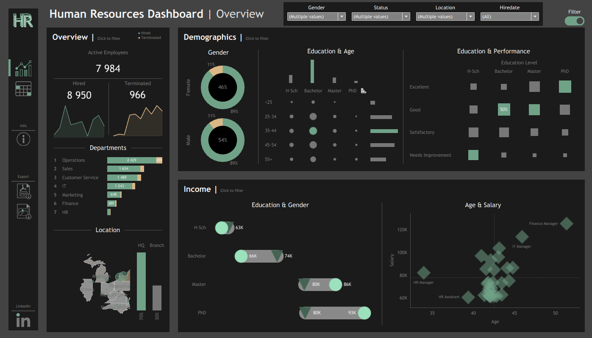
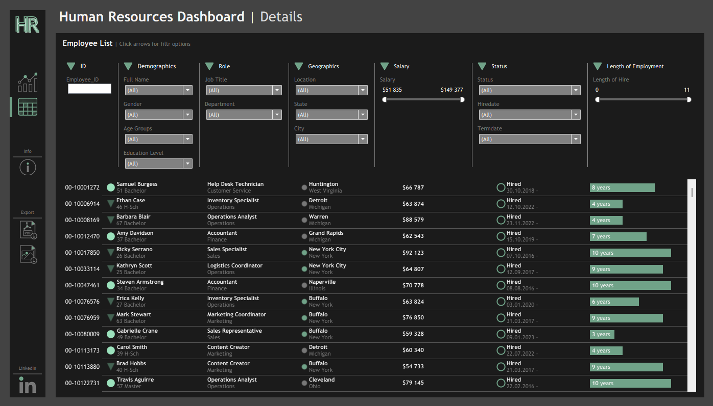
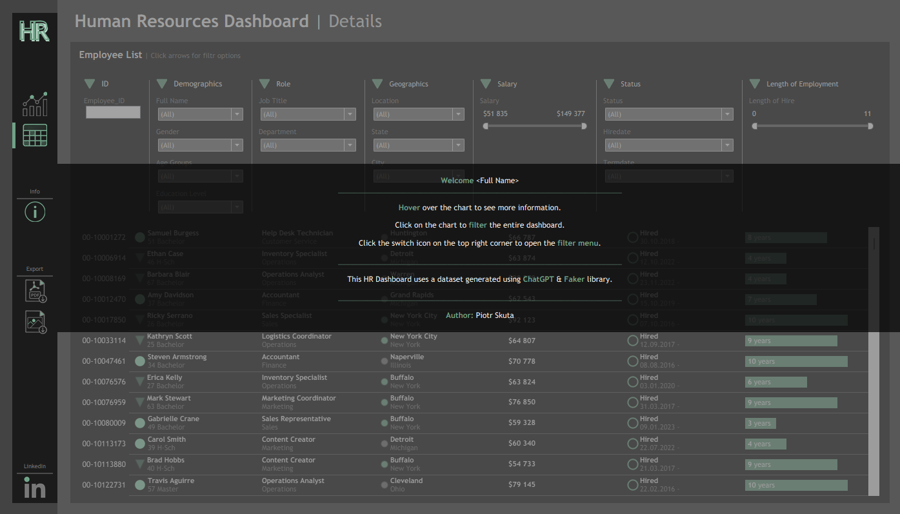
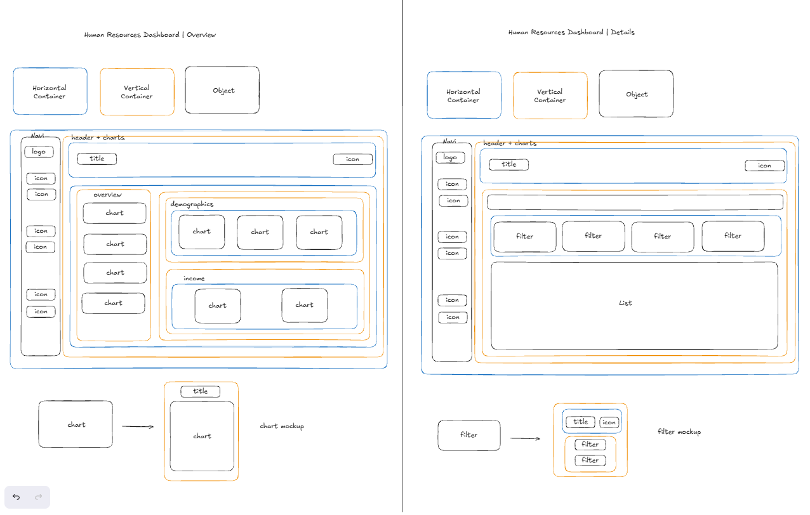

# Tableau HR Dashboard

Interactive Tableau dashboard for analyzing headcount, attrition, demographics and salaries in a company, built on a fully synthetic HR dataset.



## Tableau Public
**Explore the interactive dashboard on [Tableau Public](https://public.tableau.com/app/profile/piotr.skuta/viz/HR_dashboard_17921550892380/HRSummary).**

## Project Overview

**Goal:** provide a single interactive view of workforce size, turnover, demographics and pay.

**Business problem:** HR teams need to see who works in the company, who has left, and how headcount, education, performance and salary differ across departments, locations and demographic groups. Without a consolidated view, these questions require manual spreadsheet work.

**Intended users:** HR managers and HR/people analysts.

> All data in this project is synthetic. No real employees are represented.

## Key Features

**Dashboard 1: HR | Summary**
- **Overview panel:** Active (7,984), Hired (8,950) and Terminated (966) counts with sparklines. A department ranking shows the active-to-terminated ratio. A state map is paired with an HQ (70%) vs Branch (30%) split.
- **Demographics panel:** gender split (donut charts), education vs age, and an education vs performance rating heatmap.
- **Income panel:** salary by education and gender (dumbbell/lollipop chart), and an age vs salary scatter plot labeled with job titles.
- **Global filters:** Gender, Status, Location, Hiredate, with a toggle that shows or hides the filter menu.
- **Interactions:** clicking a chart filters the whole dashboard, and hovering shows tooltips.

**Dashboard 2: HR | Details**
- Employee list with filters grouped into sections: ID, Demographics (Full Name, Gender, Age Groups, Education Level), Role (Job Title, Department), Geographics (Location, State, City), Salary (slider), Status (Status, Hiredate, Termdate) and Length of Employment (slider, 0–11 years).
- Each row shows job title/department, location, salary, status and a tenure bar.

## Screenshots

**Overview:** headcount, department ranking, map, demographics and income panels.


**Details:** filterable employee list with tenure bars.



**Info panel:** in-dashboard usage instructions.



**Mockups:** layout planning (containers, chart and filter placeholders).



## Key Insights

> The data is synthetic, so the observations below are demonstrative and do not describe any real organization.

- The dataset covers 8,950 employees hired between 2015 and 2024. 966 (about 10.8%) are terminated and 7,984 (about 89.2%) are active.
- About 70% of employees are assigned to HQ (New York) and 30% to branch locations.
- Operations tops the department ranking, followed by Sales, Customer Service, IT, Marketing, Finance and HR.
- Salaries range from about $51,835 to $149,377 across 28 job titles and 7 departments, which the income panel breaks down by education level and gender.
- The workforce spans 8 US states and 24 cities, visualized on the state map.
- Tenure on the Details dashboard runs from 0 to 11 years, reflecting hires from 2015 onward.

## Dataset

**Source:** `data/dataset.csv`, synthetic, generated with ChatGPT and the Faker library (also stated in the dashboard's Info panel).

| Property | Value |
|----------|-------|
| Records | 8,950 employees |
| Columns | 14 |
| Separator | `;` |
| Date format | `dd/mm/yyyy` |
| Terminated / Active | 966 / 7,984 |
| Hire period | 2015–2024 |
| Departments / Job titles | 7 / 28 |
| States / Cities | 8 / 24 |
| Salary range | about $51,835 – $149,377 |

<details>
<summary>Column dictionary (14 columns)</summary>

| Column | Type | Description |
|--------|------|-------------|
| Employee_ID | Text/ID | Unique employee identifier |
| First Name | Text | Employee first name |
| Last Name | Text | Employee last name |
| Gender | Text | Employee gender |
| State | Text | US state of employment |
| City | Text | City of employment |
| Education Level | Text | Highest education level |
| Birthdate | Date | Date of birth (`dd/mm/yyyy`) |
| Hiredate | Date | Hire date (`dd/mm/yyyy`) |
| Termdate | Date | Termination date; empty for active employees |
| Department | Text | Department |
| Job Title | Text | Job title |
| Salary | Number | Salary (USD) |
| Performance Rating | Text | Performance rating category |


</details>

## Calculated Fields

<details>
<summary>Main calculated fields</summary>

| Field | Logic | Purpose |
|-------|-------|---------|
| Full Name | First Name + Last Name | Display and search in Details |
| Age | Years between Birthdate and today | Age-based analysis |
| Age Groups | Buckets: <25, 25–34, 35–44, 45–54, 55+ | Demographic grouping and filtering |
| Status | Hired / Terminated, based on whether Termdate is empty | Active vs terminated filtering |
| Location | New York = HQ, all other = Branch | HQ vs Branch split |
| Length of Hire | Years from Hiredate to Termdate, or to `TODAY()` if still active | Tenure bar and slider |
| Total Hired / Total Active / Total Terminated | Conditional `COUNT` | KPI counters and sparklines |
| % Total Hired / % Total Terminated | Share of total via `TOTAL()` | Department and group shares |
| Rank Top 1 / Rank Top 2 | `RANK` table calculation | Department ranking |
| Highlight Max | `WINDOW_MAX` comparison | Highlighting the maximum value in charts |


</details>

## Getting Started

**Requirements**
- Tableau Desktop or Tableau Public.

**Open the dashboard**
1. Clone or download this repository.
2. Open `workbook/HR_dashboard.twbx` in Tableau. The packaged workbook already contains the data extract and icons.
3. Open the **HR | Summary** and **HR | Details** dashboards. Use the left navigation to switch between them.

**Usage tips**
- Use the filter toggle to show or hide the global filters (Gender, Status, Location, Hiredate).
- Click any chart element to filter the whole dashboard, and click again to clear.
- Open the Info panel in the navigation for in-dashboard instructions.
- Use the navigation icons to export the dashboard to PDF or an image.

## Repository Structure

```text
tableau-hr-dashboard/
├── README.md
├── data/
│   └── dataset.csv
├── workbook/
│   └── HR_dashboard.twbx
├── screenshots/
│   ├── dashboard_overview.png
│   ├── dashboard_details.png
│   ├── dashboard_info.png
│   └── mockups.png
└── assets/
    └── icons/
```

| Path | Description |
|------|-------------|
| `data/dataset.csv` | Source data: 8,950 records, 14 columns |
| `workbook/HR_dashboard.twbx` | Packaged Tableau workbook with data extract and icons |
| `screenshots/` | Dashboard screenshots, Info panel and layout mockups |
| `assets/icons/` | Navigation icons used in the dashboard (source material) |

